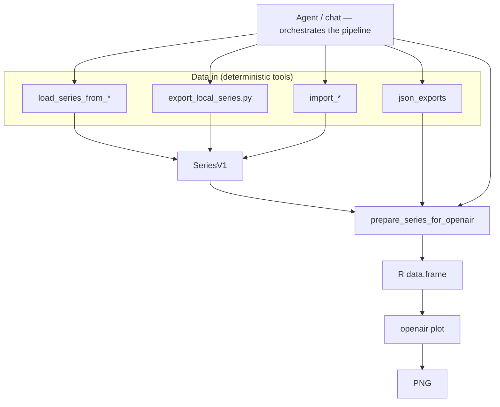

# Concepts

## The binomio

Two repos that pair at matching releases:

- **server-oss** — Python + R. Owns ingest, alignment, and every openair plot/stat call. This is where R lives.
- **client-plugin-oss** — skills, an agent persona, and MCP wiring for your IDE. No R, no calculation — it orchestrates.

Your AI client (Claude, Cursor, Codex, VS Code Copilot) talks MCP to the server, either **directly on the same machine** (stdio) or **over HTTP** to a server running elsewhere (`mcp-remote`).

## The data pipeline

The agent **orchestrates** every step. **Calculation** (parsing, alignment, plotting) stays on the server — no LLM-invented JSON, no date parsing in the chat model.

1. **Ingest** — disk load, client export script, public network import, or JSON from another MCP → **`SeriesV1`**
2. **Prepare** — `prepare_series_for_openair` aligns timestamps, granularity, and timezone; fills gaps deterministically (DST-safe)
3. **R** — builds an `openair`-shaped `data.frame(date, …)`, then calls the matching openair function (`timePlot`, `polarPlot`, …)
4. **Return** — a PNG (plus a short text summary) as an inline MCP image block

## Why not build the array in chat?

The chat model is good at *deciding what to plot*, not at *parsing dates, resampling, or aligning gaps correctly*. Every ingest tool (`load_series_from_csv`, `import_aurn`, …) and `prepare_series_for_openair` do that work deterministically and are unit-tested — the same input always produces the same output. Building a time-series array by hand in the model loses that guarantee.

## Transports — stdio vs HTTP

| | stdio | HTTP (local or remote) |
|---|---|---|
| **When** | IDE and R on the same machine | Server runs elsewhere, or you want it running independently of the IDE |
| **Needs Node.js on the client?** | No | Yes (`npx mcp-remote`) |
| **Auth** | None (local process) | Optional token header (`X-MCP-Token`) |

See [User guide → Transports](../user-guide/remote-setup.md) for the full setup of each.

## Where your data can live

| Your data | Where | What to use |
|-----------|-------|-------------|
| CSV / Excel | **Server disk** | `load_series_from_csv` / `load_series_from_excel` |
| CSV / Excel | **Your PC**, remote MCP | `export_local_series.py` on your machine → `prepare_series_for_openair(data=…)` |
| UK / EU public networks | Fetched by R | `import_aurn`, `import_europe`, `import_ukaq`, … |
| Data from another MCP | Upstream MCP | `prepare_series_for_openair(json_exports=[…])` |

Full detail: [User guide](../user-guide/ingest-local.md).
