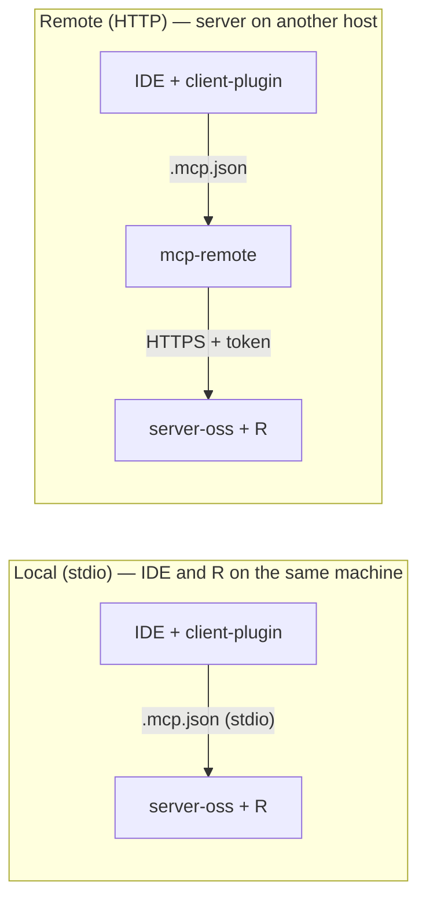

# openair-ai-kit

Air quality researchers and practitioners already have the data — sensor exports, monitoring station downloads, AURN archives, government portals. The friction is turning that data into a publication-grade [openair](https://github.com/openair-project/openair) chart without leaving your AI workflow.

This kit removes that step: raw CSV, Excel, or public network data in, deterministic openair output out, via any MCP-capable client you already use — IDEs, Claude Desktop, ChatGPT, or agents you build — alongside your usual R scripts and notebooks.

Built on **[openair](https://github.com/openair-project/openair)** (MIT) — a server (Python + R) and an IDE plugin (skills, agent, MCP config). **Not affiliated** with [openair-project](https://github.com/openair-project) maintainers.

## Why this exists

AI workflows — IDEs, desktop assistants, autonomous agents — are now a standard layer in research, reporting, and product work. The bottleneck is not intelligence; it is getting clean, structured, analysis-ready data in front of that intelligence without manual reshaping.

This kit solves the data side for air quality. It ingests heterogeneous sources (IoT real-time exports, sensor platforms, government portals, public monitoring networks, other MCPs), normalises them onto a deterministic time grid, and hands openair a clean data frame — producing the same chart you would get from a script, with the same inputs, every time. No date parsing in the chat model, no LLM-invented arrays, no guesswork.

This is one layer. Pair it with a domain knowledge base, regulatory tools, memory, and a proper agent harness and you have a system that can reason over environmental data — not just visualise it.

## Repositories

This site documents both halves of the binomio. Code lives in the two repos below; this repo is the landing page + docs.

| Repository | Role |
|------------|------|
| [**openair-3-mcp-server-oss**](https://github.com/miguel-escribano/openair-3-mcp-server-oss) | MCP server — Python + R + openair |
| [**openair-3-mcp-client-plugin-oss**](https://github.com/miguel-escribano/openair-3-mcp-client-plugin-oss) | IDE client plugin — router skill, specialist skills, agent, MCP config |

Current versions live on each repo's GitHub release tags — see the [server releases](https://github.com/miguel-escribano/openair-3-mcp-server-oss/releases) and [plugin releases](https://github.com/miguel-escribano/openair-3-mcp-client-plugin-oss/releases). The two repos are versioned together — pair matching releases.

## Architecture

**Local stdio:** IDE spawns the Python server directly — no Node, no HTTP port. **Remote HTTP:** IDE uses `mcp-remote` to reach a server elsewhere. R only needs to run on the server host, not on the client.

Start with [Getting started → Installation](getting-started/installation.md).

## Verify it works

| Setup | How |
|-------|-----|
| **Any deployed server** | Plugin [test harness](reference/testing.md) — `run_series_exercises.py` + `run_wind_exercises.py` (12/12 + 4/4) |
| **VS Code + remote MCP** | [Quickstart](getting-started/quickstart.md) — uses the committed `felisa_munarriz.json` fixture, no Excel hunt |
| **Plot picker** | [Tool catalog](reference/tools.md) |
| **Server dev only** | `pytest` + `check_integrations.py` in the server repo — pre-deploy, not a substitute for the harness |

## Scope

This binomio provides **charts and data access** through MCP, powered by openair on R. It does not include interpretation, compliance advice, or health guidance — those belong in your own reporting workflow.

For methodology, see the [openair book](https://openair-project.github.io/book/). Teams that pair generative AI with air-quality data often add a controlled knowledge base for narrative beyond plots; that layer is separate from this chart stack.
