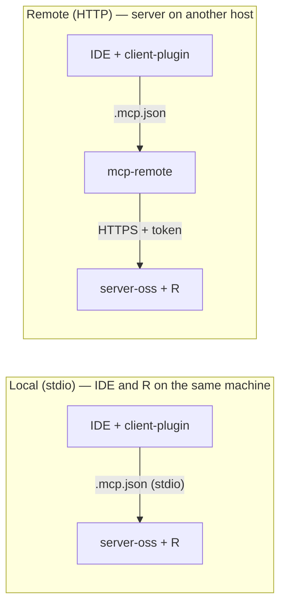
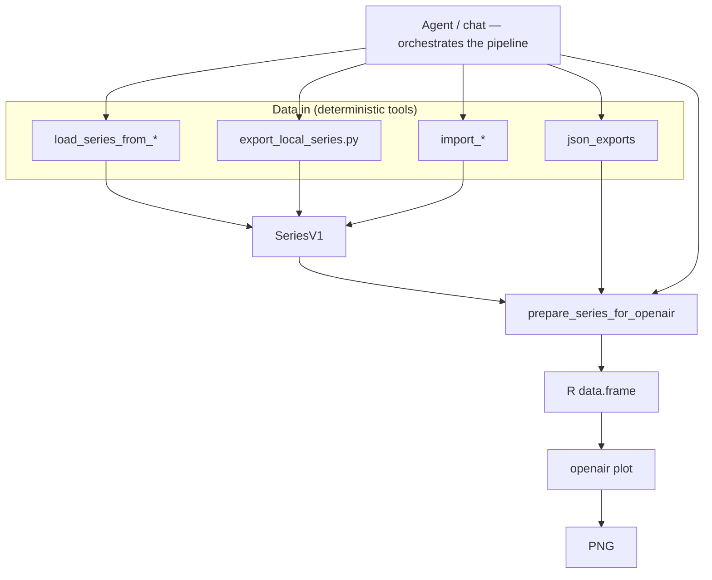

# Architecture

## Repos and roles



**client-plugin** on your MCP client · **server-oss + R** on the host you choose · stdio when both are on the same machine, HTTP + `mcp-remote` when the server is elsewhere (including `127.0.0.1`).

## Data pipeline



See [Getting started → Concepts](../getting-started/concepts.md) for the reasoning behind this split.

## Contracts

`openair_mcp/contracts.py` in the server repo is the source of truth for the Pydantic input/output types; `schemas/*.json` mirrors them for non-Python readers.

| `input_type` | Pydantic class | Used by |
|---|---|---|
| `series` | `SeriesV1` | All non-wind tools |
| `wind_series` | `WindSeriesV1` | Polar/directional tools |
| `traj_series` | `TrajSeriesV1` | Trajectory tools |
| `import_params` | `ImportParamsV1` | Import tools |

| `output_type` | Return value | Used by |
|---|---|---|
| `image` | `[summary text, Image]` → MCP `[text, image]` | All plot tools |
| `stats` | JSON dict | Stats/utility tools |
| `series` | `SeriesV1`-shaped JSON | Import tools |

Breaking changes get a new version suffix (`SeriesV2`, …) — `V1` is never overwritten in place, since the client plugin and any external consumers depend on the existing shape.

## Project layout — server repo

```
server.py                 # FastMCP entry — tool registration
openair_mcp/
├── prepare.py             # prepare_series_for_openair
├── export_bridge.py       # json_exports merge / SeriesV1
├── r_bridge.py            # R subprocess + manifest discovery
├── contracts.py           # Pydantic SeriesV1, WindSeriesV1, …
└── utils.py                # CSV → SeriesV1
r/
├── scripts/                # One .R file = one MCP tool (MANIFEST header)
└── common/                  # Shared R helpers
schemas/                     # JSON Schema for series contracts
fixtures/                    # Tiny CSV samples for pytest / check_integrations
tests/                       # Python unit tests
check_integrations.py        # Smoke suite (Python always; R when available)
```

## Project layout — client plugin repo

```
skills/openair/             # Router — auto-routes to specialist skills
skills/ingest-local/        # CSV/Excel on server disk
skills/ingest-local-export/ # Agent-run export script (local file + remote MCP)
skills/ingest-network/      # import_aurn, import_europe, …
skills/prepare-plot/        # prepare → one plot
skills/multi-mcp/           # json_exports bridge
skills/workflows/           # Pattern recipes (regional Excel, network, upload)
agents/openair-agent.md     # Guardrails O1-O6, analyst contract, routing
examples/                   # Copy-paste walkthroughs
tests/                      # Acceptance harness + felisa_munarriz.json fixture
.mcp.json.example           # Client config template (safe to commit)
```

## Tech stack

- **Python 3.11+** — MCP server, CSV pipeline, contracts
- **FastMCP 3.x** — MCP protocol
- **Pydantic** — `SeriesV1` / request validation
- **R + openair 3.x** — plots, imports, statistics ([openair](https://github.com/openair-project/openair), MIT, on CRAN)
- **jsonlite** — R JSON bridge
